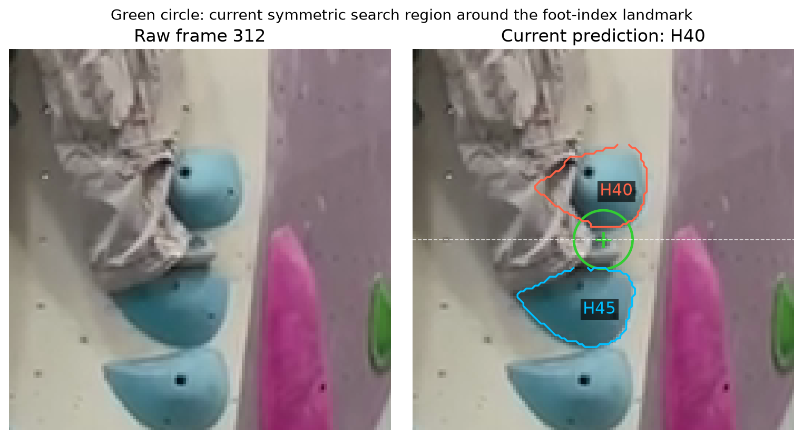

# Contact matching: iteration 0

Baseline review, 2026-10-26. Implementation reviewed at commit `04dbbf9`.
This note records the current approach and an observed failure; it does not change the matcher.

## Current approach

[contact_matching.py](../../beta_translator/contact_matching.py) predicts contacts using existing pose landmarks and reviewed hold masks:

1. Warp frame-0 hold masks into each video frame using the existing homography.
2. Compare wrists and foot-index points with nearby mask pixels. The nearest eligible hold becomes a candidate.
3. Require sufficient landmark visibility and reliable alignment. Almost equally close candidates remain ambiguous.
4. Promote a match to `likely_contact` after at least 0.5 consecutive seconds on the same hold. Missing or uncertain observations split intervals.

Current margins are symmetric: 20 pixels for wrists and 10 for feet at 720px image width, scaled by image width. Minimum visibility is 0.5; candidates within 3 pixels of the best distance are considered ambiguous. A green label means these rules passed, not a calibrated contact probability.

## Observed failure: right foot, frame 312

In `trial1.mp4`, frame 312 (10.4 seconds), the shoe appears supported by **H45 below it**, but the matcher labels **H40 above it** as `likely_contact`. These IDs belong to the reviewed 65-hold map.

| Candidate | Nearest mask pixel relative to the foot landmark | Distance |
| --- | --- | --- |
| H40, predicted | Above | 4.32 px |
| H45, apparent support | Below | 9.68 px |

Both are inside the 10px radius. H40 wins because it is closer; the 5.36px difference exceeds the 3px ambiguity threshold. The symmetric search has no preference for a supporting surface below the foot. Persistence can retain this repeated mistake instead of correcting it.

This is visual evidence of a likely mislabel, not independently verified contact or load-bearing ground truth.

## Limitations

- **Direction:** feet use the same symmetric distance rule as hands. It ignores the usual below-foot support direction during ordinary stepping.
- **Scale:** width-based scaling handles proportional resizing, but not camera distance, zoom, or changes in the climber's apparent size.
- **Landmarks and masks:** foot-index/wrist points approximate contact locations. Pose error, occlusion, segmentation boundaries, and alignment error affect matches.
- **Timing:** persistence rejects brief matches but cannot fix systematic spatial errors. Visibility gaps also fragment one physical contact into multiple intervals.
- **Meaning:** proximity does not establish grip or weight support; `no_candidate` does not establish a free limb. Section 7 still requires manual confirmation before IK.

## Ideas for later iterations, not implemented

Try a downward-biased foot region with a small allowance above for landmark error; toe landmarks need less offset than ankles. Treat direction as a prior, accounting for camera tilt and toe/heel hooks. Consider body-relative margins for scale changes.

Compare with this baseline using manually labeled examples: correct hold IDs, false contacts, missed contacts, and arrival/release timing. Check that changes preserve good matches, such as frames 104 and 208, rather than only fixing frame 312.

Reference: [The Way Up](https://arxiv.org/html/2505.12854v1) motivates landmark-region overlap, different hand/foot regions, and temporal persistence. Our segmentation-mask distance rule and pixel settings are an adaptation, not a full reproduction.
