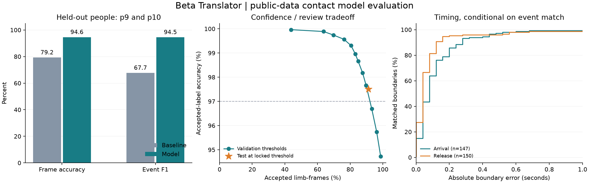

# Beta Translator contact model v1

This package contains a trained offline contact model and reproducible held-out evaluation. It predicts observed hand/foot contact with supplied holds and proposes release/arrival frames. It does not predict climbing success or physical feasibility.

## Measured held-out results

The test contains p9 and p10: four videos, 6,120 frames, on the same two public routes as training. Configuration was locked using p7 and p8 before test evaluation. There are 23,757 scored limb-frames; unannotated margins and conflicting labels are excluded.

| Metric | Geometry + temporal baseline | Trained ensemble |
|---|---:|---:|
| Limb-frame accuracy | 79.25% | 94.57% |
| Mean video accuracy | 78.91% | 94.52% |
| Contact-event precision | 54.64% | 94.22% |
| Contact-event recall | 88.95% | 94.77% |
| Contact-event F1 (IoU >= 0.5) | 67.70% | 94.49% |

The baseline uses the same frozen whole-body landmarks and reviewed hold boxes; distance and temporal settings are selected on validation. This comparison isolates learned contact inference rather than changing both the pose input and classifier.

At the deployed confidence threshold **0.800**, accepted test limb-frames have **97.51% accuracy** and cover **91.22%** of labeled limb-frames. The remaining **8.78%** require review under this confidence rule. This is a limb-frame coverage proxy, not a measured reduction in human working time.

There are 0 IK-eligible proposals out of 153 inferred hold-change proposals (0.00%). Of 0 scorable accepted proposals, 0 have correct hold/support identities and both boundaries within 0.20 s (N/A). This small conditional sample is not a physical-feasibility measurement.

Timing, conditional on successful event matching:

- Release: MAE 0.088 s; median 0.040 s; 95.33% within 0.20 s; 150 matched, uncensored boundaries.
- Arrival: MAE 0.120 s; median 0.080 s; 85.71% within 0.20 s; 147 matched, uncensored boundaries.

Read timing together with event recall: missed events have no matched boundary error. Event endpoints are inclusive; release is the next frame after contact ends.

| Test clip | Frame accuracy | Event F1 | Accepted coverage | Accepted accuracy |
|---|---:|---:|---:|---:|
| p10_green | 95.52% | 92.86% | 92.97% | 98.36% |
| p10_orange | 93.86% | 94.38% | 90.01% | 97.33% |
| p9_green | 94.16% | 93.98% | 92.15% | 96.48% |
| p9_orange | 94.56% | 96.63% | 89.14% | 97.70% |



## Validation and model selection

Validation frame accuracy: 94.11%; event F1: 94.93%. Selected-label accuracy: 97.67% at 89.75% coverage. Temperature: 1.0; decoder switch penalty: 6.0.

| Seed | Completed epochs | Updates | Selected epoch | Validation NLL |
|---|---:|---:|---:|---:|
| 17 | 24 | 1440 | 15 | 0.1957 |
| 29 | 24 | 1440 | 21 | 0.1788 |
| 43 | 24 | 1440 | 24 | 0.2035 |

Total optimizer updates: 4,320. Each network has 239,233 parameters. Training windows overlap and are sampled repeatedly; they are not independent new examples. Seeds share the same participant split. GPU execution may not be bitwise deterministic across hardware/library versions.

## Architecture and data

The frozen RTMW-x whole-body model supplies 133 keypoints, including fingertips and toes. A candidate-equivariant encoder and six residual dilated temporal convolution blocks score each supplied hold, free movement, and wall contact. The receptive field is 127 frames at 25 FPS (approximately 2.5 s of context on each side). Three validation-selected networks are averaged and temperature-calibrated. The system is offline and uses future frames.

The Way Up supplies 22 processed videos, 38,692 frames, 10 people and two routes. Train: p1–p6 (14 videos, including both p2 sessions). Validation: p7–p8 (four videos). Test: p9–p10 (four videos). The project's trial1 clip is excluded from training, selection, and calibration.

Of 940 source contact rows, one names an unspecified off-route hold. The parser masks its 11 limb-frames and 79 conflicting simultaneous-hold limb-frames. Terminal endFrame values one past the decoded video are clipped and logged. Occlusion labels are used for stratified evaluation, never as inputs. See dataset_manifest.json for per-clip audits and hashes.

The dataset has no anatomical keypoint ground truth. The pose backbone is publicly pretrained and remains frozen; this experiment trains the contact head and does not establish a new pose-localization accuracy figure.

## Integration and limitations

Open ../../Automatic_Contacts.ipynb or follow ../../docs/automatic_contacts.md. Input is a video, existing reviewed hold map, verified camera alignment, and the pretrained whole-body cache. Output is per-frame contact candidates, confidence, contact intervals, transition proposals and uncertain ranges. New candidates do not overwrite manually reviewed annotations.

Only transitions passing a separately validated movement gate, with three unchanged accepted supports, are eligible for automatic IK. **Automatic IK is disabled: no ensemble movement-gate setting met the validation requirement of at least ten accepted proposals with at least 95% correct identities/supports and both boundaries within 0.20 s. Use automatic preannotations followed by movement review.** Central 90% local path-mass ranges describe model ambiguity; they do not guarantee statistical coverage. Existing IK body proportions and wall scale remain necessary. Predictions are resampled back to native video frame IDs; temporal evidence remains limited by the 40 ms model grid. Visual contact is not a force measurement.

This evaluation measures unseen people on the same wall and routes. It does not establish unseen-gym accuracy, robust multi-person tracking, dynamic-camera accuracy, or reliability on steep walls. Confidence calibration can change under those conditions. Validate an independently labeled sample of new-wall moves before relying on automatic acceptance broadly.

## Sources and integrity

- Dataset: Anna Maschek and David Schedl, [The Way Up](https://zenodo.org/records/15196867), CC BY 4.0, DOI 10.5281/zenodo.15196867.
- Pose implementation: [RTMLib](https://github.com/Tau-J/rtmlib), Apache 2.0.
- Pose backbone: [MMPose RTMPose/RTMW](https://github.com/open-mmlab/mmpose/tree/main/projects/rtmpose). Retain upstream model/data license conditions.
- Deployment configuration SHA-256: `5c15dee5f2cf3da1fd88ced97772f62d7c6ced24607094a78e721e72fef43dcd`.
- Dataset manifest SHA-256: `bdad4d6e5a5e195987864c076958dbc4a09531899ef2e145d039592e1139fb65`.

Checkpoint hashes are verified at inference. Full numeric reports and training_summary.json accompany this card.

## Local project integration check

The model found H44 → H28, but predicted release/arrival at frames 113/136 versus the existing reference 117/128. Both reference boundaries fall outside the local model ambiguity ranges. This demonstrates new-wall timing error and overconfidence; do not interpret path-mass ranges as guaranteed coverage intervals. This clip was not used to tune the package.

```json
{
  "scope": "One existing project move; excluded from training and calibration",
  "video_sha256": "db656ed38a93a619f6df7dbd65804718860aa9191e650a1a92952ab6063a007a",
  "source_reference": "outputs/state/endpoint_annotations.json",
  "fps": 30.0,
  "from_hold": "H44",
  "to_hold": "H28",
  "reference_release": 117,
  "predicted_release": 113,
  "release_error_frames": -4,
  "reference_arrival": 128,
  "predicted_arrival": 136,
  "arrival_error_frames": 8,
  "predicted_release_range": [
    112,
    115
  ],
  "predicted_arrival_range": [
    134,
    138
  ],
  "confidence_gate_coverage": 0.7218225419664268,
  "full_clip_accuracy": null,
  "conclusion": "Correct source/target hold IDs; boundary estimates still need review. New-wall accuracy is not established."
}
```
